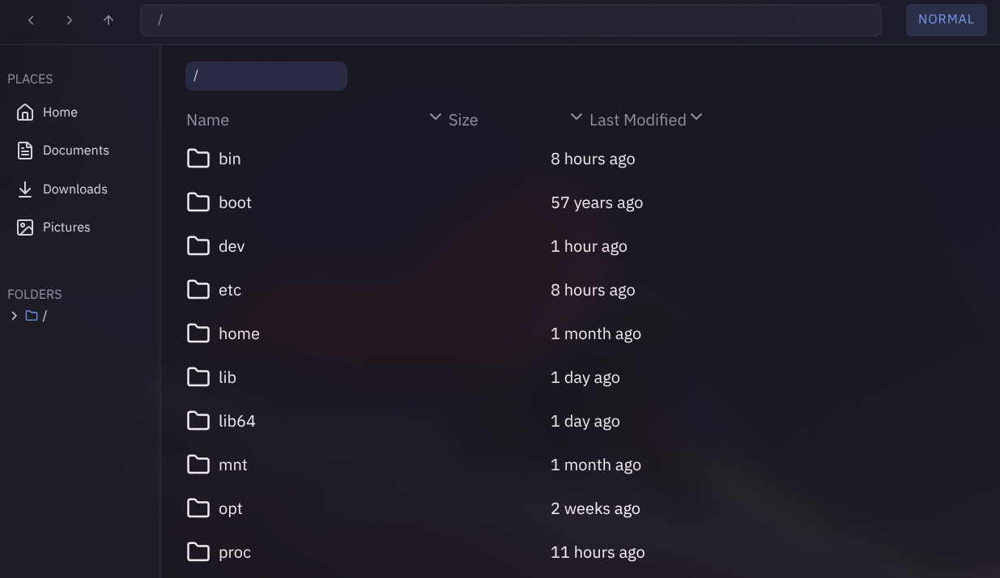

# TailFE

A cross platform, in development file manager (currently only available on Linux), built with Electron and React, with Vim-style keyboard controls.

> **Status** early development (v0.0.1-alpha)



## Keyboard Controls

### Normal Mode

| Key                         | Action                              |
| --------------------------- | ----------------------------------- |
| <kbd>i</kbd>                | Enter insert mode                   |
| <kbd><</kbd> / <kbd>></kbd> | Back / forward in the tab's history |
| <kbd>,</kbd> / <kbd>.</kbd> | Zoom out / in                       |
| <kbd>F2</kbd>               | Rename the selected file            |

### Insert Mode

| Key                                | Action                                            |
| ---------------------------------- | ------------------------------------------------- |
| <kbd>Enter</kbd>                   | Open the typed folder                             |
| <kbd>.</kbd> then <kbd>Enter</kbd> | Go up one folder per `.` typed (`..` goes up two) |
| <kbd>Backspace</kbd>               | Delete the last typed character                   |
| <kbd>Esc</kbd>                     | Back to normal mode                               |

## Building

Requirements: [Node.js](https://nodejs.org/) and npm. On Linux, `xdg-mime` (part of `xdg-utils`) is needed to open files with their default app.

```bash
git clone https://github.com/FabBeyond/tailfe.git
cd tailfe
npm install
npm run dev
```

### Scripts

## Scripts

| Command               | What it does                              |
| --------------------- | ----------------------------------------- |
| `npm run dev`         | Start in development mode with hot reload |
| `npm run start`       | Preview the production build              |
| `npm run build`       | Build the app into `out/`                 |
| `npm run build:linux` | Package for Linux                         |
| `npm run build:win`   | Package for Windows                       |
| `npm run build:mac`   | Package for macOS                         |
| `npm run lint`        | Run ESLint                                |
| `npm run format`      | Format with Prettier                      |

## Project Structure

```
src/
├── main/        Electron main process: file system access (read, move, rename, delete…)
├── preload/     Exposes a safe `window.api` to the renderer
└── renderer/    React UI
    └── src/
        ├── components/   TopBar, Sidebar, Tab, File, ContextMenu, Properties, Toast
        ├── hooks/        State: useSettings, useTabs, useUI
        └── utils/        Path helpers, file actions, drag and drop, resizing
```

## License

[MIT](LICENSE) © FabBeyond
